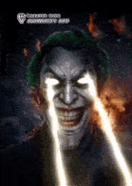
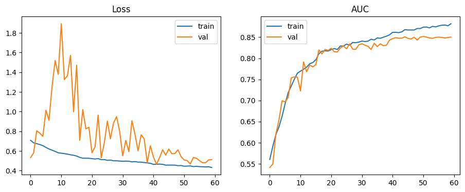
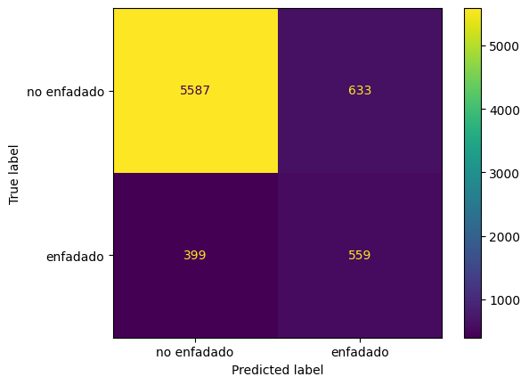

# Práctica 5. Biometría: Detección y caracterización de caras

## Filtro 1: Rayos láser

Consiste en hacer que el usuario dispare rayos láser por los ojos.

### Inspiración
Se ha tomado como inspiración el siguiente filtro:

### Controles
- `c`: calibrar filtro
- `q` / `esc`: salir

### Trabajo realizado

#### Detección de la cara

Se ha usado el modelo `face_landmarker.task` de *mediapipe* para la detección de caras.
En concreto, ha sido necesario detectar los siguientes *landmarks*:
- Los centros de los iris, para marcar el punto de inicio de los rayos y calcular la inclinación de la cabeza.
- La punta de la nariz, para estimar el cabeceo y el giro de la cabeza.

La función `create_detector()` se encarga de crear el detector a partir de una configuración.
Esta configuración es detectar una única cara en un vídeo
(`running_mode = vision.RunningMode.VIDEO`, `num_faces = 1`).

Por último, es necesario convertir el resultado obtenido por *mediapipe* (valores entre 0 y 1)
a píxeles de la imagen.
Para esto, se usa la función `get_face_points()`.
Además, esta función ordena los ojos,
de modo que el izquierdo en la imagen siempre sea el primer valor de la tupla de los resultados,
y el derecho el segundo valor.

Una vez detectada la cara, se procede al dibujado de los rayos.

#### Cálculo de la dirección de los rayos

La dirección de los rayos depende de cómo está orientada la cabeza, que se describe con tres valores: la inclinación lateral, el giro a izquierda y derecha (*yaw*) y el cabeceo arriba y abajo (*pitch*).

1. **Ejes de la cara.** Con los centros de los iris se obtiene el vector que une ambos ojos. Su ángulo, `theta`, es la inclinación lateral de la cabeza, y su módulo es la distancia entre ojos, que se usa como unidad de escala. A partir de `theta` se definen dos ejes propios de la cara: uno a lo largo de la línea de los ojos y otro perpendicular a él, apuntando hacia abajo.

2. **Yaw y pitch.** Se toma el vector que va del punto medio entre los ojos a la punta de la nariz y se proyecta sobre los dos ejes de la cara. Cada proyección se divide por la distancia entre ojos, para que el resultado no dependa de lo cerca que esté el usuario de la cámara. La componente a lo largo de la línea de los ojos es el *yaw*, y la perpendicular es el *pitch*.

3. **Dirección de cada rayo.** Se parte de una dirección base que apunta hacia abajo, abierta hacia fuera un ángulo de abertura (`BEAM_OPENING_DEG`): el ojo izquierdo hacia la izquierda y el derecho hacia la derecha. A esta dirección se le suma un desplazamiento proporcional al *yaw* y al *pitch* (con las ganancias `YAW_GAIN` y `PITCH_GAIN`), de modo que los rayos siguen hacia donde gira y cabecea la cabeza. Todo esto se calcula en el sistema de coordenadas de la cara, y por último se convierte a coordenadas de imagen, de forma que la inclinación lateral hace girar los rayos junto con la cabeza.

4. **Longitud.** La longitud del rayo es un múltiplo de la distancia entre ojos (`BEAM_LENGTH`), así que los rayos escalan automáticamente al acercarse o alejarse de la cámara.

#### Suavizado y calibración

Los *landmarks* se mueven unos píxeles de un fotograma a otro incluso con la cara quieta.
Este ruido se amplifica al calcular el *yaw* y el *pitch*,
porque se obtienen de restar y dividir cantidades pequeñas,
y haría que los rayos vibraran.

Para evitarlo, el *yaw* y el *pitch* se suavizan
con una media móvil exponencial: 
en cada fotograma, 
el valor suavizado se acerca una fracción (`SMOOTH`) a la medida nueva.
Un valor alto reacciona rápido pero deja pasar más ruido,
y un valor bajo da más estabilidad a costa de algo de retardo.
Cuando se pierde la cara,
el suavizado se reinicia para no arrastrar valores antiguos al recuperarla.

Además, la posición de la nariz en reposo no coincide exactamente con el punto medio de los ojos,
y varía de una persona a otra y según la cámara. Por eso el filtro necesita calibrarse:
al pulsar la tecla `c` mirando de frente a la cámara,
se guardan los valores suavizados de *yaw* y *pitch* de ese instante
como posición neutra 
y se restan a partir de entonces.
Después, ambos valores se limitan a un rango (`ANGLE_LIMIT`)
para que un error puntual de detección no desvíe los rayos de forma exagerada.

#### Dibujado de los rayos

El dibujado se compone de:
- un rayo láser partiendo de cada ojo
- un punto brillante en cada ojo
- un resplandor de luz difusa alrededor de cada elemento

La intensidad de los rayos y los puntos brillantes varía con el tiempo.

Una vez calculada la posición y la intensidad de los rayos,
estos se dibujan con la función `draw_beams()`.
Esta función se encarga de calcular el grosor de los rayos y el tamaño de los puntos brillantes,
que dependen directamente de la intensidad previamente calculada;
así como el tamaño final de los mismos.

Los rayos y los puntos brillantes se dibujan sobre una matriz de ceros.
Para conseguir el resplandor, se aplica un desenfoque gaussiano a esa matriz,
de modo que la luz se extienda alrededor de los elementos dibujados.
Este desenfoque se aplica sobre una versión reducida de la imagen,
para que el coste de calcularlo sea menor.

Por último, tanto la matriz con los rayos como la del resplandor se suman a la imagen captada por la cámara.
De este modo, la luz de los rayos ilumina lo que hay detrás en lugar de taparlo.

#### Parámetros

Los parámetros que controlan el comportamiento y el aspecto de los rayos se definen como constantes al inicio del script,
de modo que se pueden modificar fácilmente.
Los tamaños indicados como relativos se miden en unidades de distancia entre ojos,
por lo que escalan al acercarse o alejarse de la cámara.

| Parámetro | Descripción | Valor por defecto |
|---|---|---|
| `BEAM_OPENING_DEG` | Ángulo de abertura de los rayos hacia fuera, en grados | 20 |
| `BEAM_LENGTH` | Longitud de los rayos, relativa | 10 |
| `YAW_GAIN` | Cuánto desvía el giro de la cabeza a los rayos | 2.5 |
| `PITCH_GAIN` | Cuánto desvía el cabeceo de la cabeza a los rayos | 2.5 |
| `ANGLE_LIMIT` | Valor máximo (en valor absoluto) del *yaw* y el *pitch* tras calibrar | 0.5 |
| `SMOOTH` | Factor del suavizado del *yaw* y el *pitch* (de 0 a 1). Un valor alto reacciona más rápido, pero deja pasar más ruido | 0.3 |
| `BEAM_WIDTH` | Grosor de la capa exterior de los rayos, relativo | 0.12 |
| `FLARE_RADIUS` | Radio de los puntos brillantes de los ojos, relativo | 0.22 |
| `FLICKER` | Variación aleatoria máxima del grosor de los rayos y del tamaño de los puntos brillantes en cada fotograma (0.15 equivale a un ±15 %) | 0.15 |
| `GLOW_SIGMA_REL` | Anchura del resplandor, relativa | 0.2 |
| `GLOW_STRENGTH` | Intensidad con la que se suma el resplandor a la imagen | 1.0 |
| `RISE_SPEED` | Velocidad a la que aparecen los rayos al detectar una cara, por fotograma | 0.2 |
| `FALL_SPEED` | Velocidad a la que desaparecen los rayos al perder la cara, por fotograma | 0.1 |

### Créditos

- [Mediapipe - face landmarker](https://developers.google.com/edge/mediapipe/solutions/vision/face_landmarker)

## Filtro 2: Explosiones

Consiste en hacer que aparezca una explosión a pantalla completa cuando se detecta una cara enfadada.

El **trabajo realizado** se divide en el entrenamiento del modelo detector de enfado y en la implementación del propio filtro.

### Modelo de detección de enfado

Para decidir cuándo se dispara la explosión se ha entrenado un clasificador binario: *enfadado* frente a *no enfadado*.
El entrenamiento se ha hecho en un notebook de [Google Colab](https://drive.google.com/drive/folders/1EvSTWft7OV2LIjSTl1NjoRIlZZu-88ge?usp=sharing) con una GPU T4,
y el modelo resultante se carga después en local para ejecutar el filtro.

#### Dataset

Se ha usado FER2013, en su versión en carpetas (una por emoción) disponible en Kaggle (`msambare/fer2013`).
Las imágenes son recortes de caras de 48x48 píxeles en escala de grises.

Las siete emociones originales se han reducido a dos: la clase *angry* pasa a ser la positiva
y las otras seis se agrupan en la negativa.
Esto es suficiente para el filtro, que solo necesita saber si hay enfado o no.

La partición se ha hecho así:
- **Entrenamiento y validación:** carpeta `train` del dataset, reservando un 15 % para validación.
- **Test:** carpeta `test`, sin tocarla hasta la evaluación final.

El dataset está bastante desbalanceado:
la clase *angry* representa en torno al 14 % de las imágenes de entrenamiento.
Para compensarlo, se han usado pesos de clase inversamente proporcionales a su frecuencia en la función de pérdida.

#### Arquitectura

Se ha usado una CNN pequeña, pensada para que la inferencia sea rápida en CPU:

1. Tres bloques convolucionales con 32, 64 y 128 filtros.
   Cada bloque tiene dos convoluciones 3x3 con *batch normalization* y ReLU, seguidas de *max pooling* y *dropout* (0.25).
2. *Global average pooling*, en lugar de aplanar el mapa de características, para reducir el número de parámetros.
3. Una capa densa de 64 neuronas con *dropout* (0.4).
4. Una neurona de salida con activación sigmoide, que da la probabilidad de enfado.

El reescalado de los píxeles (0-255 a 0-1) y el *data augmentation* forman parte del propio modelo.
De este modo, en local basta con pasarle el recorte de la cara en gris y a 48x48 sin normalizar,
y el *augmentation* solo actúa durante el entrenamiento.

El *data augmentation* aplicado es:
- Volteo horizontal.
- Rotación aleatoria de hasta ±18°.
- Zoom aleatorio de hasta ±10 %.

#### Entrenamiento

| Parámetro | Valor |
|---|---|
| Optimizador | Adam, con tasa de aprendizaje inicial de 1e-3 |
| Función de pérdida | *Binary cross-entropy*, con pesos de clase |
| Tamaño de lote | 128 |
| Épocas máximas | 60 |
| *Early stopping* | Paciencia de 10 épocas, sobre la AUC de validación |
| Reducción de la tasa de aprendizaje | Se divide a la mitad tras 4 épocas sin mejorar la AUC de validación |
| Semilla | 42 |

Se conservan los pesos de la época con mejor AUC de validación.
En este entrenamiento el *early stopping* no llegó a activarse y se completaron las 60 épocas.

En las curvas se observa que la AUC de entrenamiento (≈ 0.87) y la de validación (≈ 0.85) van muy próximas,
por lo que no hay un sobreajuste apreciable.
La pérdida de validación presenta picos muy grandes al principio del entrenamiento
y se estabiliza después, aunque sigue siendo algo más ruidosa que la de entrenamiento.

#### Elección del umbral

La red devuelve una probabilidad, y hay que decidir a partir de qué valor se considera que la cara está enfadada.
El umbral se ha elegido sobre el conjunto de validación, no sobre el de test,
buscando el valor que maximiza la medida F1 de la clase *angry*.
De este modo, la evaluación final sobre test es honesta.

El umbral resultante es **0.732**.

#### Resultados

Evaluación sobre el conjunto de test de FER2013 (7178 imágenes, de las cuales 958 son *angry*):

| Métrica (clase *angry*) | Valor |
|---|---|
| Precisión | 0.47 |
| *Recall* | 0.58 |
| F1 | 0.52 |
| AUC en test | 0.853 |
| *Accuracy* global | 0.857 |
| Tiempo de inferencia en local | 23.25 ms |

Antes de interpretar estos números hay que tener en cuenta lo siguiente:

- Un clasificador que respondiera siempre "no enfadado" acertaría el 86.7 % de las veces,
  más que el modelo entrenado.
  Por eso, además de la *accuracy*, se analizan el *recall* y el F1 de la clase de interés.
- En FER2013 las etiquetas tienen ruido y las imágenes son de baja resolución,
  por lo que el enfado puede confundirse con bastante frecuencia.
- Con este umbral, el modelo detecta un 58 % de las caras enfadadas,
  pero un 10 % de las no enfadadas se clasifican como enfadadas
  y, como la clase positiva es minoritaria, menos de la mitad de las detecciones son correctas.

Para el filtro, la principal limitación es la precisión,
ya que cada falso positivo supone una explosión no deseada.

### Créditos

- [FER2013 (versión de Kaggle)](https://www.kaggle.com/datasets/msambare/fer2013)
- [TensorFlow / Keras](https://www.tensorflow.org/)